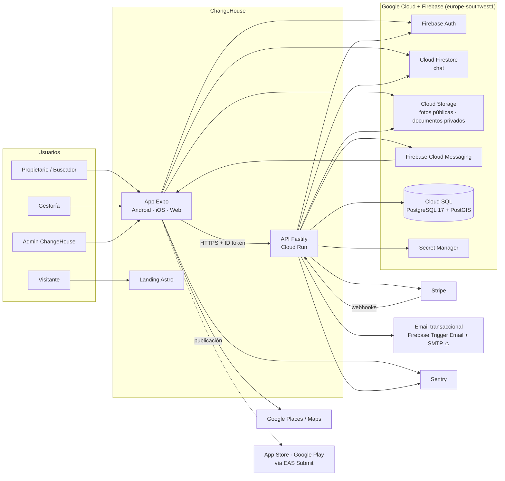
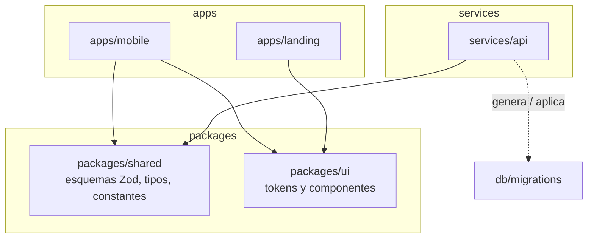
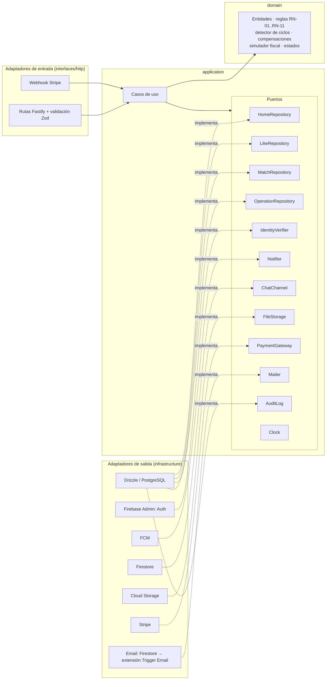

# ChangeHouse — Arquitectura del sistema

> Fuente: `docs/project.md` (autoritativo), `docs/product.md` y `README.md`.
> **Aún no hay código.** Este documento describe la arquitectura **declarada**;
> las dependencias no se han podido derivar de imports reales. Cuando exista el
> scaffold, las secciones 2 y 4 deben contrastarse con el código y las
> desviaciones registrarse en «Brechas».

---

## 1 · Vista de contexto



El portal de gestoría y el panel de administración viven, de momento, dentro de
la app web de Expo (decisión de fase 2 pendiente, README §16).

## 2 · Vista de componentes

> ⚠️ Dependencias **declaradas**, no derivadas de imports: no hay código.



| Componente | Responsabilidad |
|---|---|
| `apps/mobile` | App Expo + Expo Router. Descubrimiento, viviendas, matches, chat, perfil; panel de administración y portal de gestoría en web |
| `apps/landing` | Sitio estático Astro: propuesta de valor, blog SEO, lista de espera, páginas legales |
| `services/api` | Única autoridad de negocio: autorización, matching, compensaciones, estados de match y operación, simulador fiscal, pagos |
| `packages/shared` | Contratos compartidos app ↔ API: esquemas Zod de entrada y salida, enumerados, constantes |
| `packages/ui` | Tokens de diseño (temas claro y oscuro) y componentes reutilizables |
| `db/migrations` | Migraciones SQL generadas por drizzle-kit |
| `infra` | Scripts `gcloud` de creación de servicios y despliegue (Terraform en fase 2) |

## 3 · Aplicación del estilo arquitectónico

El sistema es **heterogéneo a propósito** (`$ARCH_STYLE`):

| Parte | Estilo | Por qué |
|---|---|---|
| `services/api` | **Hexagonal** | Lógica de negocio propia y sustancial (ciclos de 2 y 3, compensaciones, reglas VPP, simulador fiscal, máquinas de estado) que debe probarse sin infraestructura |
| `apps/mobile` | **Feature-based** | Funcionalidades autocontenidas (`auth`, `homes`, `discover`, `matches`, `chat`…) con poco acoplamiento entre sí |
| `apps/landing` | Sitio estático | Sin lógica de negocio |

### API: puertos y adaptadores



> Los nombres de los puertos son **propuesta de diseño**; se fijan en el
> `design.md` del primer change que los necesite.

La **detección de ciclos** se reparte así: la búsqueda de candidatos (las
consultas SQL de README §11) es responsabilidad del adaptador de persistencia,
detrás de `LikeRepository`; la validación de compatibilidad económica, el
cálculo de compensaciones y la clave canónica del ciclo son **dominio puro**.

### App: organización por funcionalidad

```
apps/mobile/
├── app/                    # rutas de Expo Router: componen pantallas, sin lógica
└── src/
    ├── features/<feature>/ # components/, hooks/, api/ (TanStack Query), store (Zustand)
    ├── i18n/locales/       # es-ES.json (i18next + react-i18next + expo-localization)
    └── lib/                # cliente HTTP (openapi-fetch tipado desde OpenAPI), configuración de Firebase
```

## 4 · Separación de responsabilidades

Invariantes verificables; se automatizan con `eslint-plugin-boundaries` o
`dependency-cruiser` en el lint (⚠️ herramienta pendiente de elegir al crear el
scaffold):

| # | Invariante | Verificación |
|---|---|---|
| I-1 | `services/api/src/domain/**` no importa nada fuera de `domain/**` salvo la librería estándar | regla de dependencias en lint |
| I-2 | `services/api/src/application/**` no importa `infrastructure/**` ni `interfaces/**` | regla de dependencias en lint |
| I-3 | Solo `infrastructure/**` importa `drizzle-orm`, `firebase-admin`, `stripe` y el SDK de email | regla de dependencias en lint |
| I-4 | Solo `interfaces/http/**` importa `fastify` | regla de dependencias en lint |
| I-5 | `apps/*` no importa `services/*` ni a la inversa; lo compartido va en `packages/*` | regla de dependencias + `package.json` sin dependencias cruzadas |
| I-6 | En `apps/mobile`, `features/A/**` no importa `features/B/**` | regla de dependencias en lint |
| I-7 | `packages/shared` no depende de React, React Native ni Fastify | `package.json` de `packages/shared` |
| I-8 | Ningún componente de `apps/*` usa literales de color, espaciado, radio o sombra | regla de lint sobre estilos + revisión |
| I-9 | La autorización se decide solo en la API, en un único punto (hook `preHandler` + política por caso de uso) | pruebas de la matriz RBAC |

## 5 · Decisiones y alternativas

| Decisión | Alternativas descartadas | Qué se pierde |
|---|---|---|
| **Expo (React Native) con un único código para Android, iOS y web** | Flutter; nativo por plataforma; web separada en Next.js | Rendimiento y SEO de la web inferiores a una web dedicada; dependencia del ritmo de Expo; Firebase nativo, mapas y Stripe exigen *development builds* |
| **Astro para la landing** | Servir la landing desde Expo web | Un segundo frontal que mantener; a cambio, SEO y rendimiento estáticos |
| **API propia en Fastify sobre Cloud Run** | Todo en Firebase (Firestore + Functions) | Más infraestructura que operar; a cambio, transacciones SQL y PostGIS para el matching, y dominio portable |
| **PostgreSQL + PostGIS** para el dominio | Firestore para todo | Coste fijo de Cloud SQL (~10–30 €/mes); a cambio, integridad referencial, consultas geográficas y ciclos con SQL transaccional |
| **Firestore para el chat** | Chat sobre PostgreSQL + WebSockets | Dos almacenes de datos y reglas de seguridad de Firestore que mantener alineadas con la API; a cambio, tiempo real sin servidor propio |
| **Firebase Authentication** | Auth propia; Auth0; Supabase Auth | Dependencia del proveedor; a cambio, login social (Google, Apple) gestionado |
| **Email con la extensión Trigger Email de Firebase** | Resend; SendGrid directo | Necesita un SMTP detrás y un documento de Firestore por email; a cambio, todo en el ecosistema Firebase y reintentos gestionados |
| **i18next** | Lingui; FormatJS | — ; ecosistema más amplio y compatible con Expo |
| **`openapi-fetch` tipado desde el contrato** | Axios; cliente escrito a mano | Paso de generación de tipos en el build; a cambio, la app no puede llamar a un endpoint que no esté en el contrato |
| **Drizzle ORM + drizzle-kit** | Prisma; Kysely; SQL a mano | Ecosistema más joven que Prisma; a cambio, SQL explícito, tipos ligeros y soporte de PostGIS con tipos propios |
| **Hexagonal en API, feature-based en app** | Un único estilo para todo | Dos convenciones que aprender; a cambio, rigor donde hay negocio y sencillez donde no |
| **Monorepo pnpm + Turborepo** | Repositorios separados | Configuración inicial más compleja; a cambio, esquemas Zod compartidos y cambios atómicos app + API |
| **Stripe fuera de las compras integradas** | Compras dentro de la app de Apple y Google | Riesgo de revisión en tiendas (revisar directrices antes de publicar); a cambio, sin comisión del 15–30 % sobre un servicio prestado fuera de la app |
| **Scripts `gcloud` en el MVP, Terraform en fase 2** | Terraform desde el primer día | Infraestructura menos reproducible al principio; a cambio, menos trabajo inicial para un único desarrollador |

## 6 · Evaluación del stack

| Pieza | Ventajas | Desventajas / riesgos | Ciclo de vida |
|---|---|---|---|
| TypeScript 5 `strict` | Tipos de extremo a extremo con Zod compartido | Tipado de librerías nativas irregular | Activo |
| Node.js 24 LTS | LTS reciente | — | Soporte LTS hasta abril de 2028 |
| Expo + Expo Router | Un código para tres plataformas, EAS Build/Submit | Cadencia de SDK rápida: actualizar cada pocos meses; módulos nativos fuera de Expo Go | Cada SDK se soporta unos meses tras el siguiente; planificar actualizaciones periódicas |
| Fastify | Rendimiento, esquemas, ecosistema de plugins | Menos convenciones que frameworks completos: la estructura la impone el estilo hexagonal | Activo |
| PostgreSQL 17 + PostGIS | Madurez, SQL, geografía | Coste fijo de Cloud SQL | Soporte de la comunidad hasta noviembre de 2029 |
| Drizzle | Ligero, SQL explícito | Proyecto joven: posibles cambios incompatibles en versiones menores | Activo, 0.x/1.x: fijar versiones |
| Firestore | Tiempo real sin servidor | Reglas de seguridad paralelas a la API; costes por lectura | Gestionado |
| Astro | SEO, estático | Segundo frontal | Activo |

**Riesgo principal**: un único desarrollador (README §15). Se mitiga con la
documentación, TDD y CI desde el inicio. No se recomienda ningún cambio de
stack.

## 7 · Flujos críticos

### 7.1 Like y detección de match (ciclos de 2 y 3)

```mermaid
sequenceDiagram
    actor U as Propietario A
    participant App
    participant API as API (interfaces/http)
    participant UC as Caso de uso DarLike
    participant Dom as Dominio
    participant DB as PostgreSQL
    participant N as Notifier (FCM + email)
    participant C as ChatChannel (Firestore)

    U->>App: Me gusta en vivienda B desde su vivienda A
    App->>API: POST /me/likes {fromHomeId: A, targetHomeId: B} (ID token)
    API->>API: Verifica token y autorización
    API->>UC: darLike(A→B)
    UC->>DB: BEGIN; comprueba que la vivienda origen es suya y está publicada; inserta arista (límite diario RF-45)
    UC->>DB: Busca ciclos de 2 y 3 que contienen A→B
    DB-->>UC: Candidatos
    loop Cada ciclo candidato
      UC->>Dom: Compensaciones y RN-03/RN-04/RN-06
      Dom-->>UC: Compatible / no compatible
    end
    UC->>DB: Inserta match con clave canónica única (evita duplicados)
    UC->>DB: COMMIT
    UC->>C: Crea chat de grupo
    UC->>N: Notifica a todos los participantes
    API-->>App: 201 (match creado o solo like)
```

Concurrencia: dos likes simultáneos que cierran el mismo ciclo los resuelve la
**restricción única sobre la clave canónica** del match; el segundo intento se
trata como «ya existe», no como error.

### 7.2 Paso de match a operación (fase 2)

```mermaid
sequenceDiagram
    actor P as Participantes
    participant API
    participant UC as Caso de uso ConfirmarInterés
    participant DB as PostgreSQL
    participant N as Notifier
    actor G as Gestoría

    P->>API: Confirma interés
    API->>UC: confirmar(match, participante)
    UC->>DB: Marca participante «confirma»
    alt Todos confirman
      UC->>DB: Match → en operación; crea operación; pausa otros matches de esas viviendas (RF-55)
      UC->>N: Notifica a participantes y gestoría de la zona
      G->>API: Acepta y avanza estados (documentación … firma)
    else Alguien se retira
      UC->>DB: Match → cerrado para todos (RN-10)
      UC->>N: Notifica a todos
    end
```

### 7.3 Cobro de la comisión a la firma (fase 2)

```mermaid
sequenceDiagram
    actor G as Gestoría
    participant API
    participant S as Stripe
    actor P as Participante

    G->>API: Operación → firmada
    API->>S: Crea Checkout / Payment Link por participante
    API-->>P: Enlace de pago
    P->>S: Paga
    S->>API: Webhook (firma verificada)
    API->>API: Idempotencia por id de evento; registra cobro y factura
```

---

## Brechas

| Brecha | Impacto | Cuándo se cierra |
|---|---|---|
| No hay código: dependencias e invariantes sin verificar | Este documento puede divergir del scaffold | Al crear el monorepo; repetir este prompt |
| La extensión Trigger Email de Firebase necesita un servidor SMTP de salida | Sin SMTP no se envían emails transaccionales (los de Firebase Auth —verificación y contraseña— sí funcionan) | Elegir el SMTP (decisión pendiente) |
| Herramienta de reglas de dependencia sin elegir | I-1 a I-6 sin automatizar | Scaffold del monorepo |
| Ubicación del portal de gestoría (app web de Expo o aplicación aparte) | Afecta a `apps/` y a la matriz de permisos | Fase 2 |
| Proveedor de KYC | Adaptador `IdentityVerifier` de KYC sin decidir | Fase 2 |
| Reglas de seguridad de Firestore alineadas con la autorización de la API | Riesgo de acceso al chat fuera de la API | Primer change de chat |
