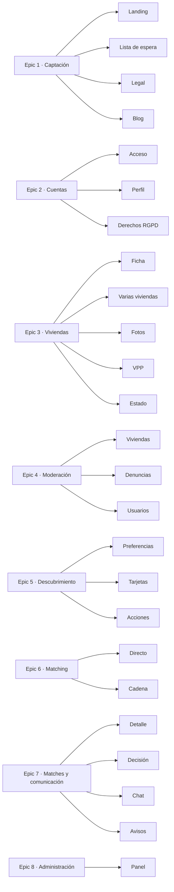
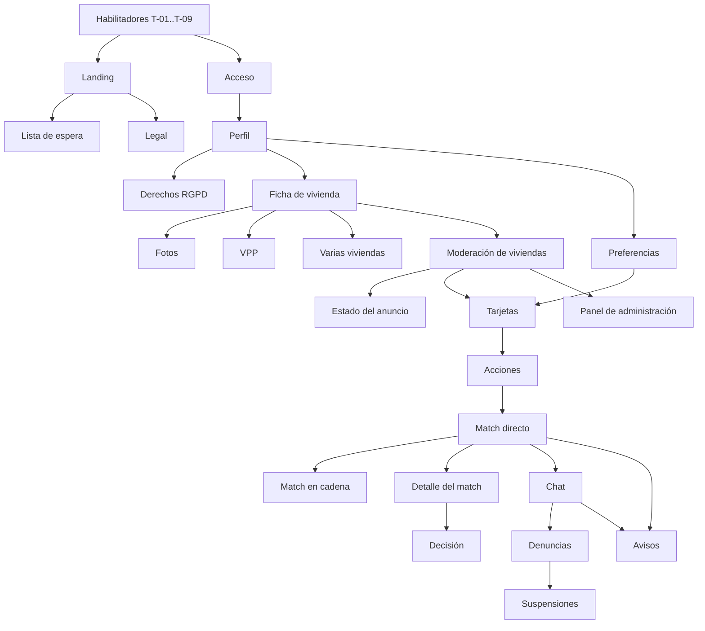

# ChangeHouse — Backlog inicial

> **Qué construir y en qué orden.** Los criterios de aceptación **no** están
> aquí: se escriben como `#### Scenario:` en el spec del change que implemente
> cada historia (`openspec/changes/<slug>/specs/`), y el issue de GitHub los
> copia desde allí.
>
> Fuentes: `docs/product.md`, `docs/project.md`, `docs/api/openapi.yaml`,
> `docs/rbac-matrix.md`. No hay specs consolidados todavía: **todas las
> capacidades son nuevas**.
>
> Jerarquía (`$TRACKER_HIERARCHY`): Epic > Feature > Story > Task. Este
> documento no crea issues: los crea el orquestador al abrir cada change.

---

## Capacidades propuestas

| Capacidad | Qué cubre |
|---|---|
| `waitlist` | Alta en la lista de espera desde la landing |
| `landing` | Web pública: propuesta, cómo funciona, FAQ, páginas legales, blog |
| `accounts` | Registro, inicio de sesión, perfil, consentimientos, supresión y exportación |
| `homes` | Ficha de vivienda, fotos, régimen VPP, ciclo de estados |
| `moderation` | Revisión de viviendas antes de publicar, denuncias, bloqueos, suspensiones |
| `search-preferences` | Zonas, filtros y compensación aceptable |
| `discovery` | Tarjetas compatibles, me gusta, descartes, deshacer, límite diario |
| `matching` | Detección de matches directos y en cadena con compatibilidad económica |
| `matches` | Ciclo de vida del match: revelado de datos, confirmar, retirarse |
| `chat` | Chat de grupo por match |
| `notifications` | Push y email de los eventos clave |
| `admin` | Panel: usuarios, métricas, registro de auditoría |

## Orden propuesto y justificación

1. **Habilitadores** (tareas, no historias): sin monorepo, CI y entornos no se
   puede entregar nada.
2. **Fase 0 — Captación**: el README fija la validación de demanda (landing +
   lista de espera, ~100 viviendas apuntadas) como condición para invertir en
   la app. Es lo que antes puede invalidar el producto.
3. **Cuentas → Viviendas → Moderación**: no hay publicación sin moderación previa
   (RF-18), así que la moderación mínima va pegada a la vivienda.
4. **Preferencias → Descubrimiento → Matching directo**: es el **mayor riesgo
   técnico y de concepto** (compatibilidad económica en ambos sentidos,
   concurrencia). Validar el match directo extremo a extremo antes que
   cualquier accesorio.
5. **Match en cadena**: el diferencial competitivo, sobre la base ya probada.
6. **Ciclo de vida del match, chat y notificaciones**: lo que convierte un match
   en una conversación.
7. **Denuncias, bloqueos y panel de administración**: necesarios antes de abrir a
   usuarios reales, pero no para validar el motor.

---

## Habilitadores (tareas técnicas)

No son historias: ningún usuario nota la diferencia. Se crean como `tipo:task`
colgando del primer Epic que los necesita.

| ID | Tarea | Disciplina |
|---|---|---|
| T-01 | Scaffold del monorepo (pnpm + Turborepo, TypeScript `strict`, ESLint, Prettier, Vitest con umbral del 80 %) con `apps/mobile`, `apps/landing`, `services/api`, `packages/shared`, `packages/ui` | devops |
| T-02 | Workflow de CI (`ci.yml`): lint, tipos, pruebas, cobertura, escaneo de dependencias; añadirlos como checks requeridos | devops |
| T-03 | `GitVersion.yml` y workflow de build con artefacto versionado | devops |
| T-04 | Proyectos de Google Cloud y Firebase para DES y PROD en `europe-southwest1`, Workload Identity Federation, Secret Manager, alerta de presupuesto | devops |
| T-05 | Cloud SQL (PostgreSQL 17 + PostGIS) y pipeline de migraciones con drizzle-kit | devops, bd |
| T-06 | Despliegue de la API en Cloud Run y de la landing en Firebase Hosting por entorno, con aprobación manual en PROD | devops |
| T-07 | Tokens de diseño y temas claro/oscuro en `packages/ui` según `docs/style-guide.md` | front |
| T-08 | Base de i18n (librería pendiente) y Sentry en app y API | front, back |
| T-09 | Autenticación y autorización centralizada en la API: verificación del ID token y prueba parametrizada de la matriz RBAC | back, qa |

---

## Epic 1 · Captación (fase 0)

### [Captación > Landing] La landing explica la propuesta y cómo funciona

**Como** visitante **quiero** entender qué es ChangeHouse, cómo funciona y quién
está detrás **para** decidir si me interesa apuntarme

**Capacidad**: `landing` — nueva
**Alcance**: propuesta de valor, «cómo funciona», historia del fundador y FAQ (RF-100). Blog fuera.
**Dependencias**: T-01, T-06, T-07
**Prioridad**: alta — condición de la fase 0
**Riesgos o dudas**: textos y FAQ los redacta el negocio; comprar el dominio changehouse.app

### [Captación > Lista de espera] Apuntarse a la lista de espera

**Como** visitante **quiero** dejar mi email, municipio, tipo de vivienda y qué busco **para** que me avisen cuando haya permutas en mi zona

**Capacidad**: `waitlist` — nueva
**Alcance**: formulario con consentimiento RGPD, protección anti-abuso, sin revelar si el email ya existía (RF-101). Consulta y exportación para el admin (`GET /admin/waitlist`).
**Dependencias**: landing
**Prioridad**: alta — mide el criterio de avance (~100 viviendas)
**Riesgos o dudas**: mecanismo anti-bots

### [Captación > Legal] Consultar aviso legal, privacidad, cookies y términos

**Como** visitante **quiero** leer las condiciones legales y elegir qué cookies acepto **para** saber cómo se tratan mis datos

**Capacidad**: `landing` — nueva
**Alcance**: páginas legales y gestión del consentimiento de cookies (RF-103, LSSI)
**Dependencias**: landing
**Prioridad**: alta — obligatorio antes de recoger emails
**Riesgos o dudas**: textos legales los aporta un abogado

### [Captación > Blog] Leer guías sobre permuta, VPP y fiscalidad

**Como** visitante **quiero** guías claras sobre la permuta **para** resolver mis dudas antes de registrarme

**Capacidad**: `landing` — nueva
**Alcance**: blog estático orientado a SEO (RF-102, prioridad S)
**Dependencias**: landing
**Prioridad**: baja — fase 2 según el README
**Riesgos o dudas**: contenidos

## Epic 2 · Cuentas

### [Cuentas > Acceso] Registrarse e iniciar sesión

**Como** particular **quiero** crear una cuenta con email y contraseña, Google o Apple **para** usar la app

**Capacidad**: `accounts` — nueva
**Alcance**: registro, inicio de sesión, verificación de email y recuperación de contraseña (RF-01, RF-02). Aceptación de términos y privacidad con versión y fecha en el alta (RF-04).
**Dependencias**: T-09
**Prioridad**: alta — puerta de todo lo demás
**Riesgos o dudas**: Apple exige ofrecer su login si se ofrece login social

### [Cuentas > Perfil] Completar mi perfil

**Como** usuario **quiero** indicar mi nombre visible, foto, municipio y teléfono privado **para** presentarme a otros participantes cuando haya un match

**Capacidad**: `accounts` — nueva
**Alcance**: perfil (RF-03), declaración de requisitos VPP y de mayor de 65 (RF-33, RF-71)
**Dependencias**: registro
**Prioridad**: alta
**Riesgos o dudas**: el teléfono solo se comparte con autorización expresa

### [Cuentas > Derechos RGPD] Eliminar mi cuenta y exportar mis datos

**Como** usuario **quiero** borrar mi cuenta y descargar mis datos desde la app **para** ejercer mis derechos

**Capacidad**: `accounts` — nueva
**Alcance**: supresión con anonimización y cierre de matches abiertos; exportación en JSON (RF-05). Exigido también por las tiendas.
**Dependencias**: perfil
**Prioridad**: alta — requisito legal y de publicación en tiendas
**Riesgos o dudas**: qué se conserva como evidencia legal (consentimientos, auditoría) y cuánto tiempo

## Epic 3 · Viviendas

### [Viviendas > Ficha] Publicar mi vivienda

**Como** propietario **quiero** dar de alta mi vivienda con sus características, rango de valor y cargas **para** que otros la descubran

**Capacidad**: `homes` — nueva
**Alcance**: alta en borrador por pasos, dirección con autocompletado guardada de forma privada, elección entre ubicación exacta pública o solo barrio o zona, rango de valor, cargas, vivienda habitual (RF-10, RF-12, RF-13, RF-15, RF-16). Envío a moderación.
**Dependencias**: perfil, T-05
**Prioridad**: alta
**Riesgos o dudas**: revisar la lista cerrada de tipos y características propuesta en el contrato

### [Viviendas > Varias viviendas] Gestionar varias viviendas

**Como** propietario con más de una vivienda **quiero** publicarlas todas y que cada una participe por separado **para** aumentar mis posibilidades de permuta

**Capacidad**: `homes` — nueva
**Alcance**: listado de mis viviendas, alta de varias, elegir desde qué vivienda descubro y doy me gusta (RF-20, adelantado al MVP por decisión del 2026-10-18)
**Dependencias**: ficha
**Prioridad**: media — amplía el MVP sin bloquear el match con una vivienda
**Riesgos o dudas**: ninguno (preferencias por usuario con sustitución por vivienda, decidido)

### [Viviendas > Fotos] Añadir las fotos de mi vivienda

**Como** propietario **quiero** subir entre 3 y 20 fotos **para** mostrar mi vivienda

**Capacidad**: `homes` — nueva
**Alcance**: subida, orden, eliminación; compresión y borrado de EXIF de ubicación (RF-11)
**Dependencias**: ficha
**Prioridad**: alta
**Riesgos o dudas**: formatos admitidos (HEIC en iOS)

### [Viviendas > VPP] Declarar que mi vivienda es protegida

**Como** propietario de una VPP **quiero** indicar el régimen, la calificación y el precio máximo legal **para** publicarla respetando sus limitaciones

**Capacidad**: `homes` — nueva
**Alcance**: régimen libre/VPPB/VPPL/VPO, fechas y precio máximo legal; el valor no puede superarlo (RF-14, RN-06)
**Dependencias**: ficha
**Prioridad**: media — segmento prioritario, pero no bloquea el match en vivienda libre
**Riesgos o dudas**: tanteo y retracto en permutas pendiente de consulta jurídica

### [Viviendas > Estado] Pausar y reactivar mi anuncio

**Como** propietario **quiero** pausar mi vivienda sin borrarla **para** dejar de aparecer temporalmente

**Capacidad**: `homes` — nueva
**Alcance**: estados publicado ↔ pausado; edición que devuelve a revisión (RF-17)
**Dependencias**: moderación de viviendas
**Prioridad**: media
**Riesgos o dudas**: qué cambios exigen nueva moderación

## Epic 4 · Moderación

### [Moderación > Viviendas] Revisar viviendas antes de publicarlas

**Como** admin **quiero** aprobar o rechazar con motivo las viviendas en revisión **para** evitar anuncios falsos o inadecuados

**Capacidad**: `moderation` — nueva
**Alcance**: cola de revisión, aprobar o rechazar con motivo visible para el propietario, registro en auditoría (RF-18, RF-90, RF-93)
**Dependencias**: ficha de vivienda
**Prioridad**: alta — sin ella ninguna vivienda se publica
**Riesgos o dudas**: criterios de moderación los define el negocio

### [Moderación > Denuncias] Denunciar y bloquear usuarios

**Como** usuario **quiero** denunciar a un usuario, una vivienda o un mensaje y bloquear a alguien **para** protegerme de abusos

**Capacidad**: `moderation` — nueva
**Alcance**: denunciar, bloquear, cola de denuncias para el admin y resolución (RF-63)
**Dependencias**: chat (para denunciar mensajes)
**Prioridad**: media — imprescindible antes de abrir a usuarios reales
**Riesgos o dudas**: alcance del bloqueo (descubrimiento y matches)

### [Moderación > Usuarios] Suspender usuarios

**Como** admin **quiero** suspender o reactivar una cuenta con motivo **para** cortar abusos reincidentes

**Capacidad**: `moderation` — nueva
**Alcance**: suspensión con auditoría
**Dependencias**: denuncias
**Prioridad**: media
**Riesgos o dudas**: qué ocurre con los matches abiertos de un suspendido

## Epic 5 · Descubrimiento

### [Descubrimiento > Preferencias] Definir qué busco y cuánto puedo compensar

**Como** usuario **quiero** indicar zonas, filtros y cuánto estoy dispuesto a pagar o quiero recibir **para** ver solo viviendas que encajan

**Capacidad**: `search-preferences` — nueva
**Alcance**: preferencias por defecto del usuario y, opcionalmente, propias de cada vivienda: zonas por municipio o radio, filtros, máximo a pagar y mínimo a recibir, y qué punto de mi rango de valor se usa para la compensación (RF-30 a RF-33, RN-03). Fecha de mudanza fuera (fase 2).
**Dependencias**: perfil
**Prioridad**: alta — sin preferencias no hay compatibilidad
**Riesgos o dudas**: ninguno adicional

### [Descubrimiento > Tarjetas] Descubrir viviendas compatibles

**Como** usuario **quiero** ver tarjetas de viviendas que cumplen mis preferencias y cuyos dueños podrían querer la mía **para** encontrar candidatas sin buscar a mano

**Capacidad**: `discovery` — nueva
**Alcance**: tarjetas con compatibilidad económica en ambos sentidos, filtros VPP, sin viviendas en operación ni descartadas, detalle de vivienda (RF-40, RF-44, RN-06, RN-11). Lista y mapa fuera (fase 2).
**Dependencias**: preferencias, moderación de viviendas
**Prioridad**: alta
**Riesgos o dudas**: rendimiento de la consulta con 50.000 viviendas; «cambio relevante» que vuelve a mostrar un descarte

### [Descubrimiento > Acciones] Dar me gusta, descartar y deshacer

**Como** propietario **quiero** marcar las viviendas que me gustan, descartar las que no y deshacer mi última acción **para** expresar interés rápidamente

**Capacidad**: `discovery` — nueva
**Alcance**: me gusta (solo con vivienda publicada), descartar, deshacer (salvo si ya hay match), límite diario configurable (RF-41, RF-45, RN-01)
**Dependencias**: tarjetas
**Prioridad**: alta
**Riesgos o dudas**: ninguno (10 likes por usuario y día, configurable por entorno)

## Epic 6 · Matching

### [Matching > Directo] Recibir un match directo

**Como** propietario **quiero** que, si al dueño de la vivienda que me gusta le gusta la mía y la diferencia de valor encaja para ambos, se cree un match **para** empezar a negociar la permuta

**Capacidad**: `matching` — nueva
**Alcance**: detección del ciclo de 2 al dar me gusta, compatibilidad económica (punto medio del rango), suma de compensaciones cero, sin duplicados ante likes concurrentes (RF-50, RN-02 a RN-04)
**Dependencias**: acciones de descubrimiento
**Prioridad**: alta — **mayor riesgo del producto**; valida el concepto
**Riesgos o dudas**: el punto de referencia del rango lo elige cada usuario (decidido)

### [Matching > Cadena] Recibir un match en cadena de tres

**Como** propietario **quiero** que se detecten cadenas A→B→C→A compatibles **para** tener más opciones que el intercambio directo

**Capacidad**: `matching` — nueva
**Alcance**: ciclo de 3, mismas reglas económicas, longitud máxima 3 (RF-51, RN-05)
**Dependencias**: match directo
**Prioridad**: alta — ventaja competitiva
**Riesgos o dudas**: rendimiento < 1 s con 50.000 viviendas (RNF-20)

## Epic 7 · Matches y comunicación

### [Matches > Detalle] Ver el match con dirección y compensación

**Como** participante **quiero** ver la dirección exacta, las fotos completas, el nombre de los demás y quién paga a quién **para** valorar si sigo adelante

**Capacidad**: `matches` — nueva
**Alcance**: revelado de datos solo a participantes, compensación estimada con aviso orientativo, teléfono solo con autorización (RF-53, RF-56, RN-08)
**Dependencias**: match directo
**Prioridad**: alta
**Riesgos o dudas**: ninguno adicional

### [Matches > Decisión] Confirmar interés o retirarme

**Como** participante **quiero** confirmar mi interés o retirarme **para** avanzar o liberar a los demás

**Capacidad**: `matches` — nueva
**Alcance**: confirmar, retirarse (cierra para todos y notifica), varios matches abiertos por vivienda (RF-54, RN-10). Cuando todos confirman, el match queda `confirmed` sin pausar los demás. Paso a operación y pausa de otros matches (RF-55) fuera (fase 2); caducidad fuera (fase 2).
**Dependencias**: detalle del match
**Prioridad**: alta
**Riesgos o dudas**: ninguno adicional

### [Comunicación > Chat] Chatear con los participantes del match

**Como** participante **quiero** un chat de grupo con texto e imágenes **para** organizar visitas y resolver dudas

**Capacidad**: `chat` — nueva
**Alcance**: chat en tiempo real por match, solo para participantes (RF-60, RC-16)
**Dependencias**: match directo
**Prioridad**: alta
**Riesgos o dudas**: borrado de los mensajes a los 12 meses del fin del match; moderación de imágenes

### [Comunicación > Avisos] Recibir avisos de matches y mensajes

**Como** usuario **quiero** notificaciones push y por email de nuevos matches, mensajes y cambios **para** no perderme nada

**Capacidad**: `notifications` — nueva
**Alcance**: push por FCM y email de eventos clave (RF-61, RF-62)
**Dependencias**: match directo, chat
**Prioridad**: alta
**Riesgos o dudas**: cuenta de Gmail para el SMTP (la crea el responsable); preferencias de notificación del usuario

## Epic 8 · Administración

### [Administración > Panel] Gestionar usuarios y ver métricas

**Como** admin **quiero** consultar usuarios y las métricas de altas, viviendas, likes, matches y operaciones **para** seguir la salud del producto

**Capacidad**: `admin` — nueva
**Alcance**: listado de usuarios, métricas por periodo, registro de auditoría (RF-90, RF-91, RF-93)
**Dependencias**: moderación
**Prioridad**: media
**Riesgos o dudas**: ninguno (zona = barrio o zona de la vivienda)

---

## Fase 2 (sin descomponer)

Se descomponen al acercarse: operación con gestoría y sus estados (RF-80 a
RF-83), simulador fiscal (RF-70 a RF-74), cobro de la comisión con Stripe
(RF-84), derivación a broker y tasadora (RF-85), KYC (RF-06), verificación de
titularidad (RF-19), lista y mapa (RF-42), favoritos (RF-43), caducidad de
matches (RF-57), plantillas de próximos pasos (RF-64), alta de gestorías
(RF-92), fecha de mudanza (RF-34).

---

## Árbol

## Dependencias

## Preguntas abiertas

1. Compra del dominio changehouse.app (el `.app` exige HTTPS en todo el dominio).
