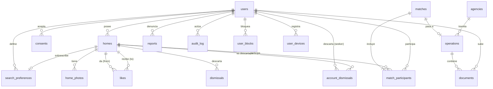
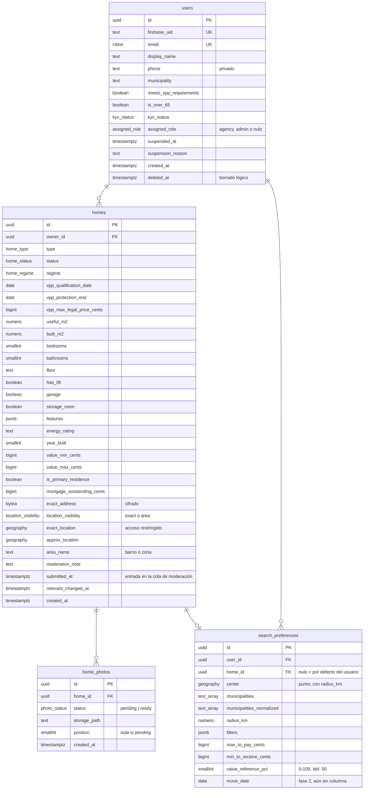
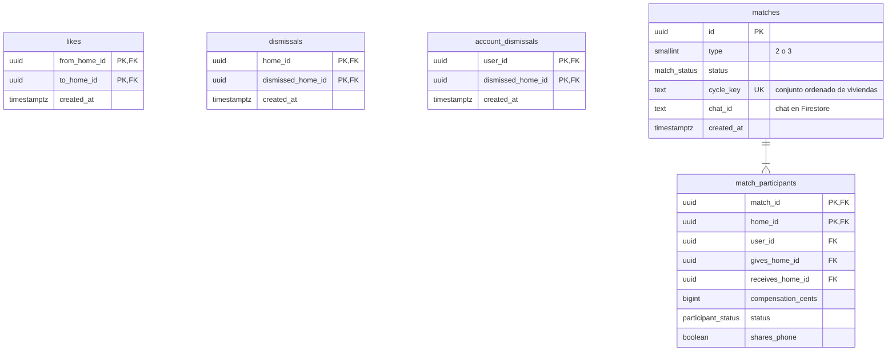
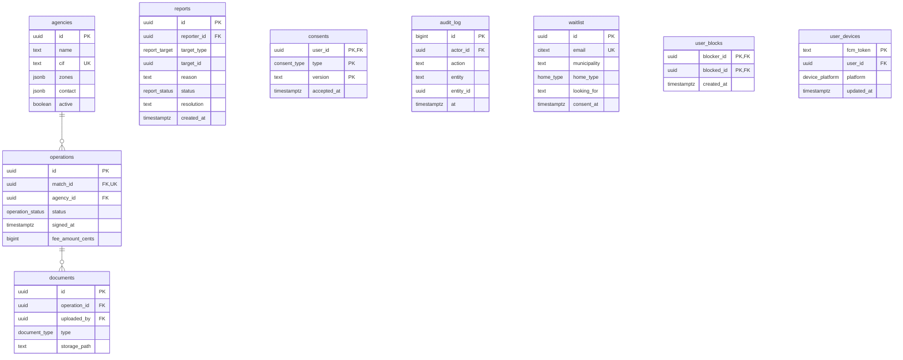

# ChangeHouse — Modelo de datos

> Motor: PostgreSQL 17 + PostGIS (Cloud SQL). ORM: Drizzle. Migraciones:
> drizzle-kit en `db/migrations`. El chat vive en Cloud Firestore y no forma
> parte de este modelo relacional.
>
> **Aún no hay esquema.** Este documento formaliza el modelo orientativo del
> README §10 con la nomenclatura que ya usa: tablas en inglés, `snake_case` y
> plural. Las decisiones que el README no toma se marcan `⚠️ SUPUESTO` o
> `⚠️ PENDIENTE`, y las anomalías se recogen en «Riesgos detectados» en lugar de
> corregirse en silencio.

---

## 1 · Diagrama entidad-relación

### General

### Cuentas y viviendas

### Grafo de interés y matches

### Operación, cumplimiento y captación

## 2 · Diccionario de entidades

Tipos de importe: **`bigint` en céntimos de euro** (sufijo `_cents`),
confirmado. Identificadores: `uuid` v7 generado en la aplicación —
⚠️ SUPUESTO, ver §3.

### `users` — persona registrada (owner, seeker, agency o admin)

| Atributo | Tipo | Oblig. | Significado |
|---|---|---|---|
| `id` | uuid | sí | Identificador interno |
| `firebase_uid` | text | sí | UID de Firebase Auth; vincula el token verificado con el usuario |
| `email` | citext | sí | Email de acceso, único sin distinguir mayúsculas |
| `display_name` | text | sí | Nombre visible para otros participantes tras el match |
| `phone` | text | no | Teléfono privado; solo se revela si el usuario lo autoriza (RF-53) |
| `municipality` | text | no | Municipio del perfil (RF-03) |
| `meets_vpp_requirements` | boolean | sí (def. `false`) | Declara cumplir los requisitos de acceso a VPP (RF-33, RN-06) |
| `is_over_65` | boolean | sí (def. `false`) | Para la exención de mayores de 65 del simulador (RF-71) |
| `kyc_status` | enum | sí (def. `none`) | Estado de verificación de identidad (fase 2). ⚠️ PENDIENTE: valores (propuesta `none`, `pending`, `verified`, `rejected`) |
| `assigned_role` | enum | no | Rol **asignado**: `agency` o `admin`; nulo para particulares. `owner`/`seeker` no se guardan: se derivan de tener vivienda publicada (`docs/rbac-matrix.md` §1) |
| `suspended_at`, `suspension_reason` | timestamptz, text | no | Suspensión por un admin; nulo si activo |
| `created_at` | timestamptz | sí | Alta |
| `deleted_at` | timestamptz | no | Borrado lógico; los datos personales se anonimizan al borrar (RF-05) |

### `homes` — vivienda publicada o en borrador

| Atributo | Tipo | Oblig. | Significado |
|---|---|---|---|
| `owner_id` | uuid FK → users | sí | Propietario |
| `type` | enum | sí | `piso`, `atico`, `duplex`, `estudio`, `bajo`, `chalet`, `adosado`, `pareado`, `casa` (propuesta de lista cerrada) |
| `status` | enum | sí | `draft`, `in_review`, `published`, `paused`, `in_operation`, `closed` (RF-17) |
| `regime` | enum | sí | `libre`, `VPPB`, `VPPL`, `VPO` (RF-14) |
| `vpp_qualification_date` | date | si VPP | Fecha de calificación definitiva |
| `vpp_protection_end` | date | no | Fin del plazo de protección |
| `vpp_max_legal_price_cents` | bigint | no | Precio máximo legal si se conoce; tope del valor (RN-06) |
| `useful_m2`, `built_m2` | numeric(7,2) | sí | Superficies útil y construida |
| `bedrooms`, `bathrooms` | smallint | sí | Dormitorios y baños |
| `floor` | text | no | Planta (admite «bajo», «ático»…) |
| `has_lift`, `garage`, `storage_room` | boolean | sí | Ascensor, garaje, trastero |
| `features` | jsonb | no | Características con claves cerradas (ver `HomeFeatures` en `docs/api/openapi.yaml`): terraza, balcón, jardín, piscina comunitaria o privada, aire acondicionado, calefacción, exterior, accesible, estado de conservación |
| `energy_rating` | text | no | Letra del certificado energético. ⚠️ SUPUESTO: A–G |
| `year_built` | smallint | no | Año de construcción |
| `value_min_cents`, `value_max_cents` | bigint | sí | Rango de valor declarado por el propietario (RF-12) |
| `is_primary_residence` | boolean | sí | Vivienda habitual (simulador fiscal, RF-16) |
| `mortgage_outstanding_cents` | bigint | no | Hipoteca pendiente aproximada (RF-15). ⚠️ El README menciona también la entidad y «otras cargas», sin columna: ver R-3 |
| `exact_address` | bytea | sí | Dirección exacta **cifrada**; solo se revela a participantes de un match (RN-08) |
| `location_visibility` | enum | sí (def. `area`) | Lo que elige el propietario: `exact` (ubicación exacta pública en el mapa) o `area` (solo barrio o zona) |
| `exact_location` | geography(Point, 4326) | sí | Punto exacto. Público solo si `location_visibility = exact`. Se guarda sin cifrar porque lo necesitan las consultas geográficas; ninguna respuesta lo expone con `area` (la dirección postal sí va cifrada) |
| `approx_location` | geography(Point, 4326) | sí | Centro del barrio o zona: lo único público si `location_visibility = area` (RF-13) |
| `area_name` | text | sí | Nombre del barrio o zona (de Google Places); también es la «zona» de las métricas |
| `moderation_note` | text | no | Motivo del último rechazo de moderación, visible para el propietario |
| `submitted_at` | timestamptz | no | Cuándo entró en la cola de moderación por última vez (`submitHome`, o un cambio relevante tras publicar). Ordena la cola (`in_review`); nula si nunca se envió |
| `relevant_changed_at` | timestamptz | sí | Se actualiza cuando cambian el rango de valor o las fotos; un descarte anterior a esta fecha vuelve a mostrarse (RF-44) |
| `published_at` | timestamptz | no | Última aprobación en moderación; ordena las tarjetas de descubrimiento y forma su cursor. Nula si nunca se publicó (relleno en la migración 0007 con el último envío o el alta) |
| `municipality`, `municipality_normalized` | text | no | Municipio de la dirección (localidad de Google Places) y su forma comparable (sin tildes, minúsculas), con la que se cruzan `search_preferences.municipalities_normalized`. Nulos en las viviendas anteriores a la migración 0007: solo cuentan por radio |

### `home_photos` — fotos de una vivienda (3–20, RF-11)

`home_id` FK, `status` (`pending` desde que se emite la URL de subida; `ready` cuando la
subida se ha confirmado y procesado), `storage_path` (ruta en el bucket público, sin EXIF de
ubicación), `position` (orden de presentación, 1–20, única por vivienda; nula mientras la foto
está `pending`) y `created_at`. Solo las fotos `ready` se devuelven y cuentan para el mínimo de 3.

### `search_preferences` — qué busca un usuario

| Atributo | Tipo | Significado |
|---|---|---|
| `user_id` | uuid FK | Usuario dueño de las preferencias |
| `home_id` | uuid FK, nulo | **Nulo** = preferencias por defecto del usuario, que valen para todas sus viviendas. **Con valor** = preferencias propias de esa vivienda, que sustituyen por completo a las de por defecto al buscar y emparejar desde ella |
| `center` | geography(Point) | Centro de la zona de interés, siempre junto a `radius_km` (polígonos, fuera del MVP) |
| `municipalities` | text[] | Municipios de interés tal y como los eligió el usuario (para mostrarlos), sin repetidos. Ver R-2 |
| `municipalities_normalized` | text[] | Los mismos municipios sin tildes, en minúsculas y con espacios colapsados, para compararlos con `homes.municipality`; hasta que haya catálogo con código INE |
| `radius_km` | numeric(6,2) | Radio alrededor del centro: 0 < r ≤ 200 |
| `filters` | jsonb | Tipo, superficie mínima, dormitorios… (RF-31), con las claves cerradas de `SearchPreferences.filters` |
| `max_to_pay_cents` | bigint | Máximo que paga como compensación (RF-32) |
| `min_to_receive_cents` | bigint | Mínimo que acepta recibir (RF-32) |
| `value_reference_pct` | smallint | Punto del rango de valor que se usa para la compensación, elegido por el usuario: 0 = mínimo, 100 = máximo, 50 = punto medio por defecto (RN-03) |
| `move_date` | date | Fecha deseada orientativa (fase 2). **Sin columna todavía**: no está en el contrato |

Restricciones: un índice único parcial por ámbito (`user_id` donde `home_id IS NULL`, y `home_id` donde no es
nulo), `home_id` con `ON DELETE CASCADE` (borrar la vivienda borra sus preferencias), `CHECK` de zona
(`center` o algún municipio), de `center` y `radius_km` a la vez, de `radius_km` y de `value_reference_pct`.
`PUT` reemplaza la fila entera. Las preferencias efectivas de una vivienda son las suyas si existen; si no,
las de su propietario; si no hay ninguna, no hay búsqueda.

### `likes` — arista del grafo de interés

`from_home_id` → `to_home_id`: el propietario de la vivienda origen quiere la
vivienda destino. Clave primaria compuesta; `created_at`. Un usuario con varias
viviendas da me gusta **desde una vivienda concreta**: cada vivienda participa
en el matching de forma independiente (RF-20). `CHECK (from_home_id <> to_home_id)`; índices
`likes(to_home_id, from_home_id)` y `likes(created_at)`. Al ser un me gusta deshecho (`undoLastAction`) la fila
se borra, lo que devuelve el cupo diario.

### `dismissals` — descartes (RF-44)

`home_id` descarta `dismissed_home_id`. El descarte deja de aplicarse si
`homes.relevant_changed_at` de la vivienda descartada es posterior a
`created_at` del descarte (RF-44). Repetir un descarte renueva `created_at`; deshacerlo borra la fila.

### `account_dismissals` — descartes de un `seeker`

Un `seeker` no tiene vivienda desde la que descartar: `user_id` descarta `dismissed_home_id`, con la misma
regla de cambio relevante que `dismissals`. Clave primaria `(user_id, dismissed_home_id)`, `CASCADE` en
ambas claves ajenas. El descubrimiento en modo `seeker` los excluye.

### `matches` — ciclo de interés recíproco y compatible

`type` 2 o 3; `status` `open`, `confirmed`, `in_operation`, `closed`,
`expired` (en el MVP, cuando todos confirman el match queda en `confirmed`
sin pausar los demás matches de esas viviendas; `in_operation` llega en la
fase 2); `chat_id`; `cycle_key` único = identificadores de vivienda ordenados y
concatenados (evita duplicados, README §11).

Implementada en `add-direct-match` (migración `0009_matches`): `type` con
`CHECK (type IN (2, 3))`, `status` (`match_status`) `open` por defecto,
`chat_id` nulo hasta `add-match-chat`, `cycle_key` con la restricción única
`matches_cycle_key_unique` (identificadores ordenados y unidos con `:`). El
match se crea en la misma transacción que el «Me gusta» que cierra el ciclo,
con `INSERT … ON CONFLICT (cycle_key) DO NOTHING RETURNING`; si no devuelve
fila, se lee el existente. Antes de insertar la arista se toma
`pg_advisory_xact_lock` sobre la clave del par `{from, to}`, de modo que dos
«Me gusta» cruzados simultáneos se serializan y forman un único match.

### `match_participants` — cada vivienda de un match

`gives_home_id` (la que entrega, igual a `home_id`), `receives_home_id`,
`compensation_cents` (positivo = paga, negativo = recibe; la suma en un match
es 0, RN-04), `status` `pending`, `confirmed`, `withdrawn`, y `shares_phone`
(autoriza mostrar su teléfono a los demás participantes, RF-53).

Clave primaria `(match_id, home_id)`; `match_id` en cascada desde `matches`;
`home_id`, `gives_home_id`, `receives_home_id` y `user_id` con `RESTRICT` (una
vivienda o un usuario no se borran mientras figuren en un match). Checks
`gives_home_id = home_id` y `receives_home_id <> gives_home_id`. `status`
(`participant_status`) `pending` por defecto y `shares_phone` `false`. Índices
`(user_id, match_id)` para «Mis matches» y `(gives_home_id, receives_home_id)`
para saber si un «Me gusta» forma parte de un match no cerrado (no se deshace).

Implementada en `add-match-details-and-decisions` (sin migración: `shares_phone`
ya existe desde `0009_matches`):

- `shares_phone` solo lo cambia el propio participante (`setPhoneSharing`) mientras
  el match está `open` o `confirmed`; el teléfono se lee de `users.phone` y solo se
  devuelve en `getMatch` a los participantes si `shares_phone` es verdadero.
- Confirmar y retirarse leen el match con `SELECT … FOR UPDATE` dentro de una
  transacción. Participante `pending → confirmed`; el match pasa `open →
  confirmed` cuando todos están `confirmed`. Retirarse (desde `open` o
  `confirmed`) deja al participante `withdrawn` y el match `closed`; en la misma
  transacción se inserta en `audit_log` una fila (`action = 'match.withdraw'`,
  `entity = 'match'`, `entity_id` = el match, `actor_id` = el participante).
- Un match `closed` deja de contar en `isLikeInMatch`: el «Me gusta» que lo formó
  se puede deshacer.
- La dirección exacta (`homes.exact_address`) solo se descifra en `getMatch` y
  solo para participantes; la lectura de las viviendas para el admin y para la
  forma pública no selecciona esa columna.

### `operations` — permuta en tramitación (fase 2)

`match_id` único, `agency_id`, `status` `proposed`, `documentation`,
`appraisal`, `financing`, `signing_scheduled`, `signed`, `cancelled` (RF-81),
`signed_at`, `fee_amount_cents`.

### `agencies` — gestorías asociadas

`name`, `cif` único, `zones` (ver R-2), `contact`, `active`.

### `documents` — documentación privada de una operación

`operation_id`, `uploaded_by`, `type`, `storage_path` en el bucket **privado**;
acceso por URL firmada de corta duración (RNF-03).

### `reports` — denuncias (RF-63)

`reporter_id`, `target_type` (`user`, `home`, `message`), `target_id`
(polimórfico, ver R-6), `reason`, `status` (`open`, `resolved`, `dismissed`),
`resolution`, `created_at`.

### `user_blocks` — bloqueos entre usuarios (RF-63)

`blocker_id` bloquea a `blocked_id`. Los dos dejan de verse mutuamente en el
descubrimiento y no pueden formar match entre sí.

### `user_devices` — tokens de notificación push (RF-61)

`fcm_token` (clave), `user_id`, `platform` (`android`, `ios`, `web`),
`updated_at`. Se borran los tokens que FCM declara inválidos.

### `consents` — registro de consentimientos (RF-04, RNF-13)

`user_id`, `type` (términos, privacidad, analítica, derivación a terceros…),
`version`, `accepted_at`. Solo inserción: un cambio de versión es una fila
nueva.

### `audit_log` — acciones administrativas y sensibles (RF-93)

`id` (bigint identidad), `actor_id` (FK → `users`, `RESTRICT`, obligatorio), `action`, `entity`, `entity_id` (uuid), `at`.
Solo inserción: un disparador rechaza `UPDATE` y `DELETE` (también al propietario de la tabla) y la
migración retira `UPDATE`, `DELETE` y `TRUNCATE` al rol de la aplicación `changehouse_app` cuando existe.
Se escribe en la misma transacción que la acción auditada. Acciones actuales: `home.approve` y
`home.reject` sobre la entidad `home`; el motivo de un rechazo no se guarda aquí (vive en
`homes.moderation_note`). La concesión del rol `admin` con `admin:grant` no genera entrada (no hay
actor usuario): queda en el log estructurado del proceso.
Retención: 2 años (`$LOG_RETENTION`).

### `waitlist` — lista de espera de la landing (RF-101)

`email` único, `municipality`, `home_type`, `looking_for`, `consent_at`.

## 3 · Reglas de integridad

**Claves primarias**: `uuid` v7 generado en la aplicación (⚠️ SUPUESTO: no
expone volumen, es ordenable y permite crear entidades en el dominio antes de
persistir). `audit_log` usa `bigint` identidad.

**Claves foráneas y borrado:**

| FK | Ante borrado del padre | Motivo |
|---|---|---|
| `homes.owner_id` → `users` | `RESTRICT` | El usuario se borra lógicamente; sus viviendas pasan a `closed` en el caso de uso |
| `home_photos.home_id` → `homes` | `CASCADE` | Sin vivienda no hay fotos (el fichero se borra aparte) |
| `search_preferences.user_id` → `users` | `CASCADE` | — |
| `search_preferences.home_id` → `homes` | `CASCADE` | Las preferencias de una vivienda desaparecen con ella |
| `likes.*`, `dismissals.*` → `homes` | `CASCADE` | Aristas sin sentido sin sus nodos |
| `match_participants.match_id` → `matches` | `CASCADE` | — |
| `match_participants.home_id`/`user_id` → `homes`/`users` | `RESTRICT` | El histórico de matches se conserva |
| `operations.match_id` → `matches` | `RESTRICT` | — |
| `operations.agency_id` → `agencies` | `RESTRICT` | Las gestorías se desactivan, no se borran |
| `documents.operation_id` → `operations` | `RESTRICT` | Documentación legal: no se borra en cascada |
| `consents.user_id`, `audit_log.actor_id`, `reports.reporter_id` → `users` | `RESTRICT` | Evidencia legal |
| `user_blocks.*`, `user_devices.user_id` → `users` | `CASCADE` | Sin valor legal |

**Restricciones que expresan reglas de negocio** (en el esquema, no solo en el
código):

| Restricción | Regla |
|---|---|
| `CHECK (value_min_cents > 0 AND value_min_cents <= value_max_cents)` | RF-12 |
| `CHECK (regime = 'libre' OR vpp_max_legal_price_cents IS NULL OR value_max_cents <= vpp_max_legal_price_cents)` | RN-06 |
| `CHECK (regime = 'libre' OR vpp_qualification_date IS NOT NULL)` | RF-14 ⚠️ SUPUESTO: obligatoria en VPP |
| `CHECK (from_home_id <> to_home_id)` en `likes` y `dismissals` | Sin auto-likes |
| `UNIQUE (cycle_key)` en `matches` | Sin matches duplicados del mismo ciclo |
| `CHECK (type IN (2,3))` en `matches` | RN-05 |
| `UNIQUE (match_id)` en `operations` | Una operación por match |
| `UNIQUE (firebase_uid)`, `UNIQUE (email)` en `users` | — |
| `CHECK (position BETWEEN 1 AND 20)` en `home_photos` | RF-11 (el mínimo de 3 se valida en el caso de uso de publicación) |
| `CHECK (value_reference_pct BETWEEN 0 AND 100)` en `search_preferences` | RN-03 (punto del rango por usuario) |
| `UNIQUE (user_id) WHERE home_id IS NULL` y `UNIQUE (home_id)` en `search_preferences` | Una preferencia por defecto por usuario y como mucho una por vivienda |
| `CHECK (blocker_id <> blocked_id)` en `user_blocks` | Sin auto-bloqueo |
| `CHECK (assigned_role IS NULL OR NOT EXISTS viviendas)` — en el caso de uso, no en el esquema | `agency` y `admin` no publican viviendas (`docs/rbac-matrix.md` §1) |

La suma cero de compensaciones (RN-04) y la compatibilidad económica (RN-03)
afectan a varias filas: se garantizan en el **dominio**, dentro de la misma
transacción que crea el match, y se cubren con pruebas de propiedades.

**Estrategia de borrado**: lógico en `users` (`deleted_at` + anonimización de
`email`, `display_name`, `phone`), físico en datos derivados sin valor legal
(fotos, likes, descartes, preferencias, bloqueos, dispositivos). Lo que es evidencia legal
(`consents`, `audit_log`, `documents`, `operations`) no se borra.

## 4 · Consultas frecuentes y rendimiento

| Acceso | Consulta | Índice que la sostiene |
|---|---|---|
| Detección de ciclo de 2 | `likes WHERE from_home_id = :y AND to_home_id = :x` | PK `(from_home_id, to_home_id)` |
| Detección de ciclo de 3 | join `likes l1` (from = :y) con `likes l2` (from = l1.to, to = :x) | PK + índice `likes(to_home_id, from_home_id)` |
| Tarjetas de descubrimiento | viviendas `published` dentro de la zona, filtros, no descartadas, no propias, compatibilidad económica en ambos sentidos | GIST en `homes(approx_location)`; parcial `homes(status) WHERE status = 'published'`; PK de `dismissals` |
| Matches de un usuario | `match_participants WHERE user_id = :u` | índice `match_participants(user_id)` |
| Matches abiertos de una vivienda (para pausar al entrar en operación) | `match_participants WHERE home_id = :h` | PK `(match_id, home_id)` + índice `(home_id)` |
| Límite diario de likes (10 por usuario y día, configurable por entorno) | likes de las viviendas de un usuario desde las 00:00 (Europe/Madrid) | índice `likes(from_home_id, created_at)` |
| Moderación | `homes WHERE status = 'in_review' ORDER BY created_at` | parcial `homes(created_at) WHERE status = 'in_review'` |

Volumetría declarada: **50.000 viviendas** con detección de ciclos < 1 s
(RNF-20) y 1.000 viviendas en los primeros 6 meses. ⚠️ PENDIENTE: likes por
usuario y día, que determinan el tamaño de `likes`. Sin ese dato no se
proponen particionado, desnormalización ni caché.

## 5 · Datos sensibles

`$NORMATIVA`: RGPD/LOPDGDD. `$DATOS_CATEGORIA_ESPECIAL`: ninguno del art. 9 en
el MVP (confirmado).

| Atributo | Clase | Protección |
|---|---|---|
| `homes.exact_address` | Personal sensible (localiza el domicilio) | Cifrado en aplicación (clave en Secret Manager); solo se descifra para participantes de un match |
| `users.phone` | Personal | Acceso restringido; solo se revela con autorización del usuario |
| `users.email`, `display_name`, `firebase_uid` | Personal | Anonimización al borrar la cuenta |
| `homes.exact_location` | Personal sensible si es privada | Solo pública si el propietario elige `exact`; si no, solo se expone `approx_location` (centro del barrio o zona) |
| `users.is_over_65` | Personal (deriva la edad) | No se muestra a terceros; solo para el simulador |
| `users.meets_vpp_requirements` | Personal (indica nivel de renta) | No se muestra a terceros |
| `homes.mortgage_outstanding_cents` | Económico personal | No se muestra a terceros; solo para el simulador y la gestoría |
| `homes.approx_location` | Personal aproximado | Centro del barrio o zona, nunca el punto exacto desplazado |
| `home_photos` | Puede contener datos personales | Eliminación de EXIF de ubicación al subir (RF-11) |
| `documents` | Notas simples, tasaciones | Bucket privado, URL firmada de corta duración; las notas simples no se vuelcan a la base de datos (README §13) |
| `waitlist.email` | Personal | Consentimiento registrado; se conserva hasta el lanzamiento + 12 meses o hasta la baja |
| `audit_log`, `consents` | Evidencia | Solo inserción; auditoría 2 años; consentimientos mientras exista la cuenta y el plazo de prescripción |
| KYC (fase 2) | Posible categoría especial (biometría) | Fuera del modelo hasta elegir proveedor; preferible no almacenar biometría propia |

## 6 · Evolución del esquema

- Cambios con **drizzle-kit**: el esquema TypeScript genera migraciones SQL en
  `db/migrations`, que se revisan y se versionan. Nunca `push` directo contra
  DES ni PROD.
- Las migraciones se aplican en el despliegue, **antes** de la nueva versión de
  la API, y deben ser compatibles con la versión anterior (expandir → migrar →
  contraer).
- **Incompatibles** (requieren coordinación con el despliegue en dos pasos):
  renombrar o borrar columnas o tablas, cambiar tipos, añadir `NOT NULL` sin
  valor por defecto, cambiar valores de un enum en uso.
- Las extensiones (`postgis`, `citext`) se crean en la primera migración.

## Riesgos detectados

| # | Riesgo | Propuesta |
|---|---|---|
| R-1 | ~~Tipo de los importes sin fijar~~ | **Resuelto**: `bigint` en céntimos |
| R-2 | Campos multivalor en una columna: `features`, `filters`, `zones`, `areas`/`municipalities` | Aceptable para filtros flexibles; pero `agencies.zones` se usa para asignar gestoría por zona y debería ser una tabla `agency_zones` o geografía |
| R-3 | Cargas «entidad» y «otras cargas» (RF-15) sin columna | Añadir `mortgage_entity` y `other_charges`, o confirmar que no se guardan |
| R-4 | ~~Rol único guardado~~ | **Resuelto**: `assigned_role` (`agency`, `admin`); `owner`/`seeker` derivados |
| R-5 | ~~Descartes sin versión~~ | **Resuelto**: `homes.relevant_changed_at` |
| R-6 | `reports.target_id` polimórfico sin FK | Aceptable para denuncias; validar existencia en el caso de uso |
| R-7 | `match_participants.user_id` duplica `homes.owner_id` | Útil como instantánea si la vivienda cambia de dueño; documentarlo como intencionado |
| R-8 | `agency` necesita vincular usuario y `agencies`; no hay relación | Añadir `users.agency_id` o tabla `agency_members` (fase 2) |
| R-9 | Los mensajes de chat denunciados viven en Firestore | La moderación necesita copiar el mensaje denunciado a `reports` como evidencia |
