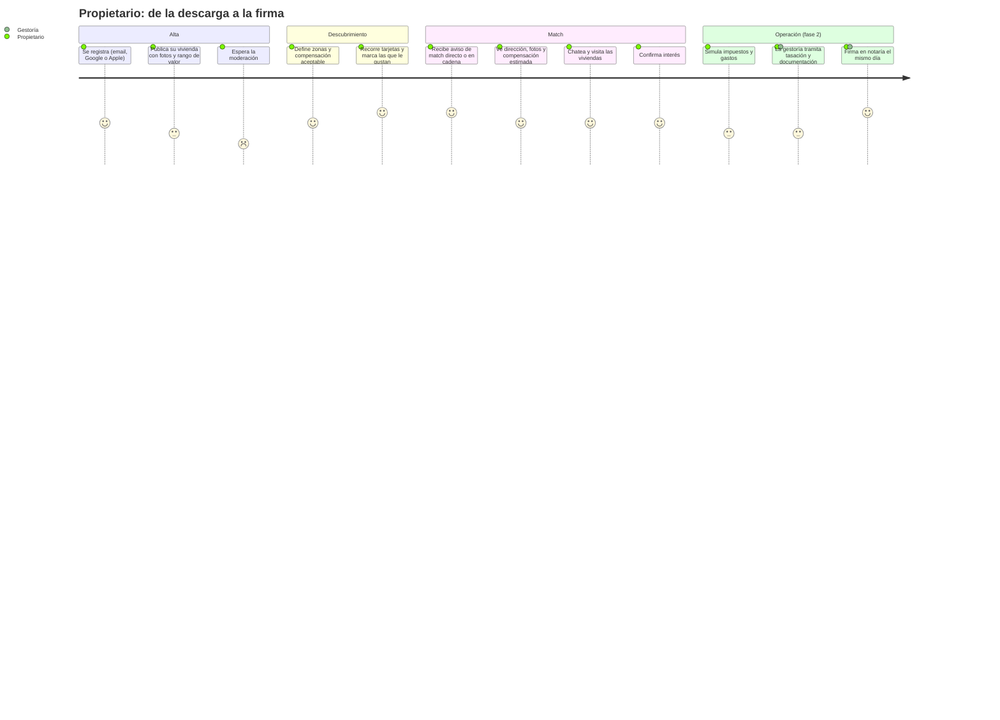
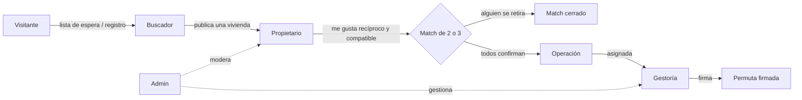
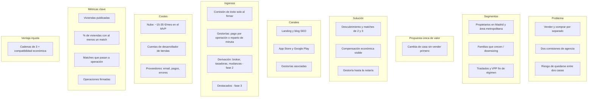

# ChangeHouse — Documento de producto

> **Cambia de casa sin vender primero.**
>
> Documento para personas: el porqué y el para quién. Los valores técnicos
> están en `docs/project.md`. Fuente: `README.md` (aún no hay código; todo lo
> descrito aquí es intención, no funcionalidad implementada).

---

## 1 · Descripción general

ChangeHouse es una aplicación móvil y web para **intercambiar viviendas en
propiedad entre particulares** (permuta). Cada usuario publica su vivienda,
marca las que le interesan y, cuando hay interés recíproco —entre dos
viviendas o en una cadena de tres—, la plataforma pone en contacto a los
propietarios, les muestra quién paga a quién la diferencia de valor y les
acompaña, a través de gestorías asociadas, hasta la firma ante notario.

## 2 · Objetivo y valor

### Problema

Cambiar de vivienda en propiedad obliga hoy a **vender y comprar por
separado**:

- Dos operaciones y dos comisiones de agencia.
- Riesgo de vender sin haber encontrado casa, o de comprar sin haber vendido.
- Necesidad de financiar la compra completa, aunque la vivienda nueva valga
  casi lo mismo que la actual.

### A quién

Propietarios de vivienda en Madrid capital y su área metropolitana que quieren
cambiar de casa. Segmentos prioritarios:

| Segmento | Necesidad |
|---|---|
| Familias que crecen ↔ personas que reducen (*downsizing*) | Más espacio frente a menos espacio; intereses naturalmente complementarios |
| Ciudad ↔ municipio cercano o costa | Cambio de entorno sin pasar por dos compraventas |
| Traslados laborales entre ciudades | Cambiar de ciudad sin quedarse entre dos casas |
| Propietarios de VPPL/VPO cerca del fin del régimen de protección | Salida ordenada respetando las limitaciones legales |

### Valor añadido

| Beneficio | Qué significa para el usuario |
|---|---|
| **Sin agencia** | Se ahorra la comisión de venta, habitualmente entre el 3 % y el 5 % más IVA por parte |
| **Sin quedarse sin casa** | Las transmisiones se firman el mismo día |
| **Menos hipoteca** | Solo se financia la **diferencia de valor** entre viviendas |
| **Impuestos claros** | Un simulador muestra ITP, IRPF y plusvalía municipal con las exenciones aplicables (reinversión en vivienda habitual, mayores de 65) |
| **Acompañamiento** | Una gestoría asociada tramita la operación hasta la notaría |

> **Lo que ChangeHouse nunca comunica:** «ahorro fiscal por escriturar menos».
> Los valores de escritura deben ser valores de mercado defendibles; la
> plataforma no propone ni recomienda valores de escritura.

### Ventajas competitivas

- **Cadenas de tres**: aumentan mucho las posibilidades frente al intercambio
  directo, en el que los dos propietarios tienen que quererse mutuamente.
- **Compatibilidad económica desde el principio**: solo se proponen
  intercambios en los que cada parte puede asumir la diferencia de valor que
  le toca.
- **Acompañamiento hasta la firma**, no solo un tablón de anuncios.
- **App móvil** con descubrimiento ágil de viviendas.

## 3 · Análisis del contexto

| Alternativa | País | Por qué no basta |
|---|---|---|
| Muévete (muevete.house) | España | Competidor directo en vivienda en propiedad; sin cadenas ni app conocida |
| Idealista / Fotocasa | España | Anuncios que «aceptan permuta», sin emparejamiento: el usuario busca a mano |
| Tauschwohnung, Wohnungsswap | Alemania | Permuta de alquileres, no de propiedad (Wohnungsswap admite tríos) |
| HomeSwapper, House Exchange | Reino Unido | Vivienda social con cadenas de tres o más, modelo B2G; no aplica al mercado libre español |
| Vender y comprar por separado | — | Es lo que se hace hoy: dos comisiones, riesgo de desfase y financiación completa |

> ⚠️ PENDIENTE: no hay datos de tamaño de mercado (número de operaciones de
> permuta, volumen de compraventas de reposición en Madrid). No se incluyen
> cifras hasta disponer de una fuente.

## 4 · Funcionalidades principales

| Funcionalidad | Qué hace | Para quién | Fase |
|---|---|---|---|
| Ficha de vivienda | Publicar la vivienda con fotos, características, régimen (libre o VPP), cargas y un **rango de valor** declarado. La dirección exacta queda oculta | Propietario | MVP |
| Preferencias | Zonas, filtros y **cuánto se está dispuesto a pagar o se quiere recibir** como diferencia | Propietario, buscador | MVP |
| Descubrimiento | Tarjetas de viviendas compatibles: me gusta, descartar, ver detalle | Propietario, buscador | MVP |
| Match directo y en cadena | Detecta interés recíproco entre 2 o 3 viviendas económicamente compatibles, notifica a todos y abre un chat de grupo | Propietario | MVP |
| Chat y notificaciones | Conversación en tiempo real entre participantes; avisos push y por email | Propietario | MVP |
| Moderación y administración | Revisión de anuncios antes de publicarse, denuncias, métricas | Equipo ChangeHouse | MVP |
| Landing y lista de espera | Web pública con la propuesta, guías y alta en lista de espera | Visitante | Fase 0 |
| Simulador fiscal | Estimación orientativa de impuestos y gastos por participante, y comparativa permuta frente a vender y comprar | Propietario | Fase 2 |
| Operación con gestoría | Paso del match a operación, seguimiento hasta la firma y documentación privada | Propietario, gestoría | Fase 2 |
| Verificación | Identidad (KYC) y titularidad (nota simple) antes de operar | Propietario | Fase 2 |

## 5 · Recorrido del usuario

### Propietario

### Flujo general entre perfiles

El **buscador** (registrado sin vivienda publicada) puede mirar, pero no genera
matches hasta que publica su vivienda.

## 6 · Modelo de negocio

**La comisión solo se cobra al firmar**, nunca por match. El importe (fijo por
parte o porcentaje) está pendiente de validar con usuarios y gestorías.

### Objetivos iniciales (Madrid, primeros 6 meses tras el MVP)

| Métrica | Objetivo |
|---|---|
| Viviendas publicadas | 1.000 |
| % de viviendas con al menos un match | 30 % |
| Matches de 3 sobre el total | ≥ 15 % |
| Matches que pasan a operación | 5 % |
| Operaciones firmadas | 10 |
| Gestorías asociadas activas | 5 |

### Fases

| Fase | Objetivo | Criterio de avance |
|---|---|---|
| 0 · Validación | Medir demanda sin app: landing, lista de espera, contacto con gestorías | ~100 viviendas apuntadas en Madrid y al menos una gestoría interesada |
| 1 · MVP | Primeros matches reales | — |
| 2 · Operación | Cerrar permutas: simulador, gestorías, firma, cobro, KYC | — |
| 3 · Datos | Precios de cierre por zona, valor de referencia, alertas de fin de protección VPP | — |
| 4 · Ampliación | Alquiler, otras ciudades, B2G | — |

## 7 · Fuera de alcance

ChangeHouse **no**:

- Recomienda ni propone **valores de escritura**. Muestra rangos orientativos y
  remite a tasación y gestoría.
- Cobra por match ni custodia dinero: no hay pagos dentro de la app ni
  *escrow* en el MVP; el dinero de la compensación circula entre los
  participantes fuera de la plataforma.
- Hace tasaciones automáticas propias.
- Gestiona alquileres ni vivienda pública B2G (fase 4).
- Forma cadenas de más de tres viviendas.
- Construye una base de datos consultable con notas simples: solo las usa para
  verificar la titularidad que aporta el propio usuario.
- Sustituye al asesoramiento fiscal o jurídico: el simulador es orientativo.

---

## Preguntas abiertas

1. Importe y forma de la comisión de éxito (fijo por parte o porcentaje).
2. Datos de tamaño de mercado para el apartado 3.
3. Si el tanteo y retracto de la VPP aplica a la permuta (consulta jurídica).
4. Si alguna comunidad autónoma exige inscripción como agente inmobiliario
   según el grado de intermediación.
